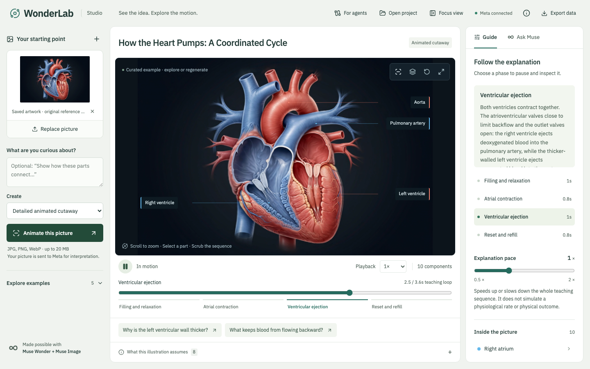
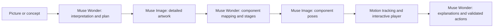

# WonderLab

**Turn diagrams into interactive animated explanations.**

Built by **Kaanchan Krishna**, solo entrant in the **indie developer track** of the Meta Global AI Developer Hackathon.

[Studio](https://wonderlab-diagram-playground.firmtrail.chatgpt.site/) · [Agent integration guide](https://wonderlab-diagram-playground.firmtrail.chatgpt.site/integrations) · [MCP setup](mcp/README.md)

> The studio's audience is controlled separately from this repository. In public-demo mode, saved examples and project import work without a key; paid generation and AI chat are disabled. Run locally with your Meta key for the complete workflow.



## What it does

Upload an explanatory picture or describe a concept. WonderLab creates a detailed cutaway, a coordinated teaching sequence, and illustrated component poses. You can play, slow, scrub, inspect parts, and ask Muse to navigate the explanation. Flow guides are optional; the main animation changes the artwork itself.

An optional 3D mode supports spatial exploration. A standalone MCP prototype lets custom agents generate projects asynchronously and hand the resulting JSON file to the same studio.

## How Meta is used



- **`muse-wonder-1.0`** interprets the source, produces structured plans, maps components, and explains or navigates the current project.
- **`muse-image-1.0`** produces the cutaway illustration and additional poses for the teaching stages.
- **Three.js/WebGL and JSFeat** perform rendering and bidirectional optical-flow interpolation in the browser. The model does not generate executable code.
- **Zod and semantic validation** check references, numeric bounds, actions, and phase/pose consistency.

The project does not use SAM or Meta open-weight models.

## Run locally

Requires Node.js **22.13+**. A Meta Model API key is needed for new generation and AI chat; the bundled examples work without it.

```sh
npm ci
cp .env.example .dev.vars
# Set MODEL_API_KEY in .dev.vars. Keep it out of Git.
npm run dev -- --host 127.0.0.1 --port 3000
```

Open `http://127.0.0.1:3000`.

1. Try the heart or landscape cutaway.
2. Upload JPG, PNG, or WebP input; the browser resizes it before sending it to Meta.
3. Choose **Detailed animated cutaway** or **Explorable 3D scene**.
4. Generate, inspect the assumptions, then explore the timeline and components.
5. Export project data, or use **Open project** to import a generated artifact.

Generation uses multiple model calls and may take several minutes. The UI reports actual pipeline stages. The public preview intentionally does not provide unrestricted access to the owner's API credits.

## Agent workflows through MCP

The included server supports **stdio** and **authenticated Streamable HTTP**. It runs alongside your agent infrastructure, not inside the hosted studio.

```sh
# From the project directory; .dev.vars contains your Meta key.
node --env-file=.dev.vars --import tsx mcp/server.ts

# Discover tools using the official SDK example client:
node --env-file=.dev.vars mcp/examples/client.mjs
```

Tools: `list_examples`, `plan_animation`, `create_visualization`, `get_job`, and `get_manifest`.

Generation returns a job ID immediately. Poll for completion, retrieve the project artifact, and open it in the studio. Idempotent request keys prevent accidental duplicate jobs. One generation runs at a time; completed results persist on disk. See [the MCP guide](mcp/README.md) for HTTP authentication, allowed image directories, an example client, and limits.

## Verification

```sh
npm run typecheck
npm test
npm run build
```

The current suite contains **26 passing tests**, including scene validation, optical-flow direction, timeline behavior, request boundaries, public-demo access, MCP transports, asynchronous jobs, idempotency, persistence, and file-path protection.

[Evaluation notes](EVALUATION.md) distinguish live checks from assumptions. The small test set is not a representative scientific-accuracy benchmark.

## Scope and limitations

- Cutaways are **illustrative image-based animations**, not photogrammetric reconstructions or validated anatomical rigs. Generated details, correspondence, and interpolation can be wrong.
- Geometry, timing, and scale may be inferred. The interface exposes source readings and assumptions.
- The small-angle simple pendulum is the currently implemented calculated physical model: `T = 2π√(L/g)`, with an ideal massless string, no damping, and small amplitudes.
- The standalone MCP server is a **single-tenant prototype**. It has no distributed queue, OAuth, or automatic replay after process failure. Keep it running while jobs execute.
- Human expert review, a real-user learning study, and a public load test have not been completed.

## Privacy and public previews

The Meta key remains on the server. Local env files and job artifacts are Git-ignored. Source images are sent to Meta for inference but are not retained by the web app. Generated media is kept in browser memory and included in project export. Large image payloads are omitted from chat requests.

Before making a hosted preview public, set **`PUBLIC_DEMO_MODE=true`**. This blocks the three paid web API actions while leaving the saved projects, playback, project import/export, and integration documentation available. MCP deployments use their own configured Meta key and authentication.

## Project map

| Location                                | Responsibility                                                      |
| --------------------------------------- | ------------------------------------------------------------------- |
| `components/wonderlab/Workbench.tsx`    | Studio, source input, controls, conversation, project import/export |
| `components/wonderlab/CutawayView.tsx`  | Image-pose animation and teaching timeline                          |
| `components/wonderlab/SceneView.tsx`    | Optional 3D renderer                                                |
| `components/wonderlab/motion.worker.ts` | Background motion estimation                                        |
| `lib/wonderlab/cutaway.ts`              | Meta interpretation, artwork, mapping, and pose pipeline            |
| `lib/wonderlab/scene.ts`                | Scene contracts and implemented physical behavior                   |
| `app/api/`                              | Web endpoints and public-demo gating                                |
| `mcp/`                                  | Standalone agent server, job storage, client example, documentation |
| `tests/`                                | Automated checks                                                    |

## Credits and provenance

The application was developed during the hackathon with AI coding assistance, using an existing framework starter and open-source libraries. The custom interpretation, animation orchestration, validation, studio, and MCP workflow are the project work; underlying libraries are credited rather than claimed as original algorithms.

The bundled SVG diagrams were authored for this project. The original user-provided heart reference is not distributed; that example shows generated artwork in its source panel. Cutaway illustrations and poses were generated with Meta Muse Image. The Earth texture comes from the [Three.js examples](https://github.com/mrdoob/three.js/blob/dev/examples/textures/planets/earth_atmos_2048.jpg). Third-party notices and supplied licenses are retained, including [JSFeat's MIT notice](public/licenses/jsfeat.txt).
